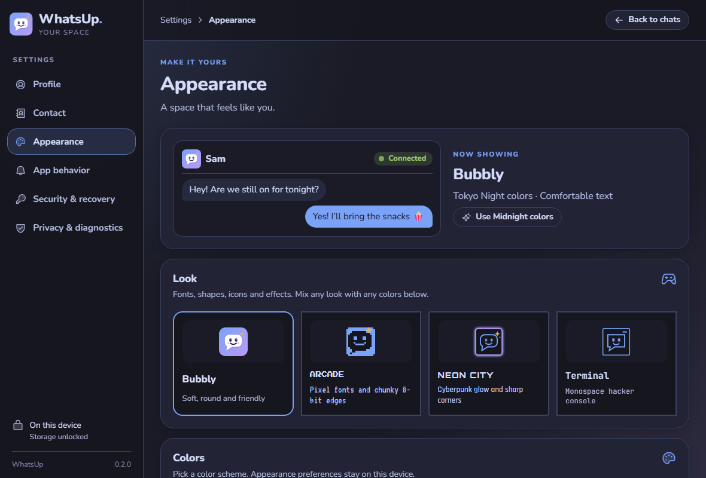
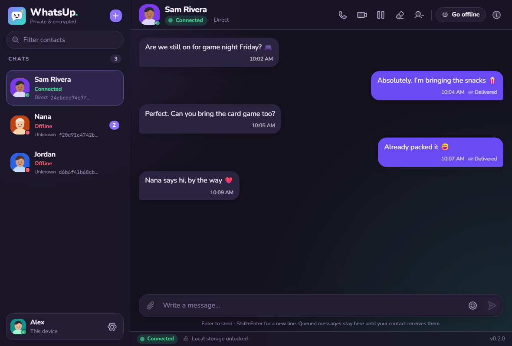
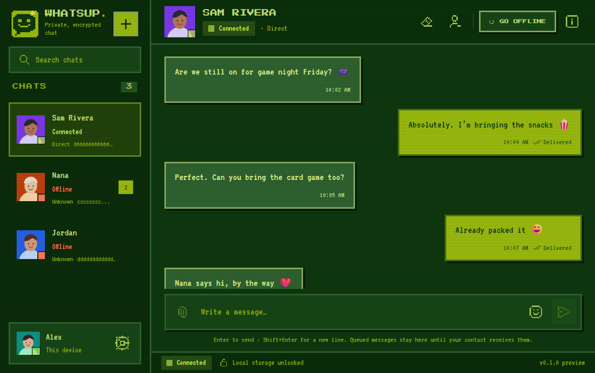
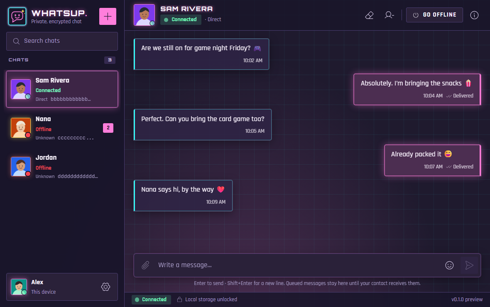
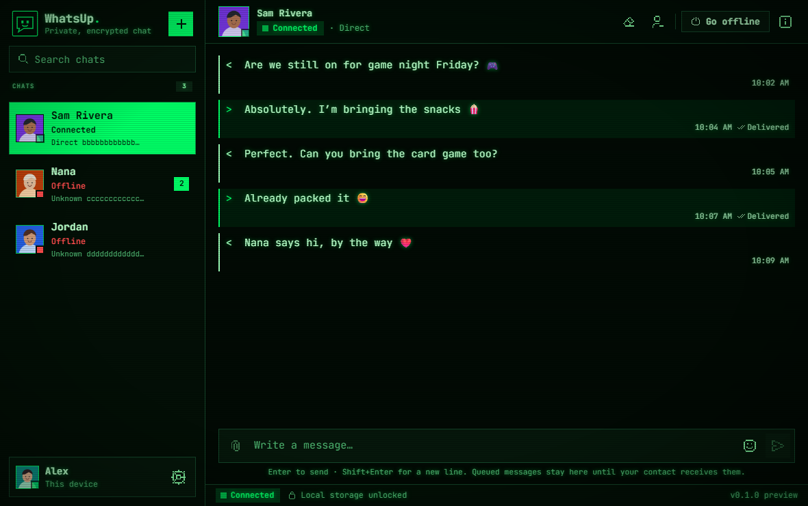
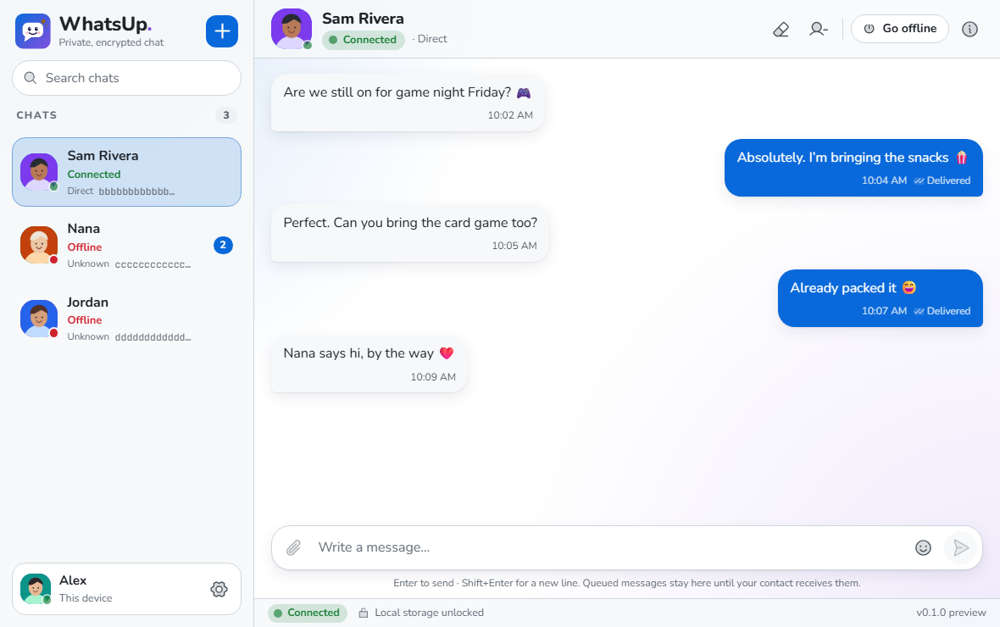

# WhatsUp

WhatsUp is a private desktop messenger for Windows and Linux. You pair with each
person once, using an invitation that works a single time, and from then on your
two computers talk over an encrypted connection: messages, files, voice calls
and video calls.
There is no account to create and no server that stores your messages. Every
conversation is between exactly two devices; there are no group chats.





> Current version: **0.2.0**. The Windows installer is not code-signed and
> updates are installed by hand. The [security information](SECURITY.md)
> describes the design in detail, including its current limits.

## Private by design

- **Only your two devices can read what you send.** Messages, files and calls
  travel inside a WireGuard tunnel with a pre-shared key unique to each contact,
  and every connection is authenticated again against the identity you approved
  when you paired.
- **A relay can't read your traffic.** WhatsUp connects directly when it can.
  When it uses a relay, the relay carries only encrypted packets it can't open.
- **Your history is encrypted on your device.** Messages, queued messages,
  attachments and contact details are stored encrypted, protected by your
  operating system's credential store and an optional passphrase.
- **No accounts, no message servers, no analytics.** There is nothing to sign up
  for and nowhere your conversations are kept except your own two computers.
- **Open source.** Every release is built in the open with checksums, a
  dependency list and a build attestation you can verify.

## Getting started

Install WhatsUp on both computers, pair once, then start chatting. Use the same
version on both devices when possible. Download packages only from this
repository's Releases page.

### Windows

Run `WhatsUp-0.2.0-windows-x64-setup.exe`. It installs for your Windows account
without changing your existing identity, contacts or history. Quit WhatsUp from
its tray before upgrading. Windows 10 or later on x64 is required, along with
Microsoft's [WebView2 Evergreen Runtime](https://developer.microsoft.com/en-us/microsoft-edge/webview2/).
The installer checks for the runtime; it does not download it automatically.

The installer is not code-signed, so Windows may show a SmartScreen warning.
Verify the download first. If you trust its source, choose **More info → Run
anyway**.
Do not disable SmartScreen globally. A managed computer may block unsigned apps.

### Ubuntu

On Ubuntu 24.04 x64, install the downloaded package in a terminal:

```bash
sudo apt install ./whatsup_0.2.0_amd64.deb
```

The package installs the launcher, runtime dependencies and the scoped AppArmor
policy WebKit needs. Launch **WhatsUp** from the application menu. Upgrading keeps
your local profile; uninstalling the application keeps personal data too. See
[Linux support](docs/linux-support.md) for desktop and Secret Service requirements.

### Arch Linux / Omarchy

For installation on Arch Linux or Omarchy, follow the
[Arch installation guide](docs/arch-installation.md).

### Verify a download

Each release includes `SHA256SUMS` and a dependency SBOM. On Windows:

```powershell
Get-FileHash .\WhatsUp-0.2.0-windows-x64-setup.exe -Algorithm SHA256
```

Compare the entire hash with that file's line in `SHA256SUMS`. On Ubuntu, with
the downloaded package and checksum file in the same folder:

```bash
sha256sum --ignore-missing --check SHA256SUMS
```

A checksum detects changed bytes; it does not authenticate the publisher.
Releases are built by GitHub release CI. Verify a package's build attestation
with GitHub CLI:

```text
gh attestation verify WhatsUp-0.2.0-windows-x64-setup.exe --repo bigsk1/whatsup --signer-workflow bigsk1/whatsup/.github/workflows/release.yml
gh attestation verify whatsup_0.2.0_amd64.deb --repo bigsk1/whatsup --signer-workflow bigsk1/whatsup/.github/workflows/release.yml
```

An attestation links a package to its source and workflow. It is not Windows
code signing or a security audit. Releases are labelled **vX.Y.Z (unsigned)**:
the packages are not Authenticode-signed. In-app updates stay disabled.

Next, follow [Pair with someone](#pair-with-someone) and choose a relay service
you trust. Before depending on WhatsUp, use **Settings → Security & recovery →
Export recovery copy…** and keep the export and its recovery passphrase safe.

## What it does

- Up to 32 saved contacts, each with its own one-to-one conversation and an
  approved device identity.
- Encrypted message history on your device, plus an offline queue that sends
  what you wrote once your contact's app is running again.
- Photos, videos and files up to 2 GiB each. The receiver approves every
  transfer, and transfers can be paused, resumed or cancelled.
- Voice and video calls with a connected contact, encrypted between your two
  devices. Calls stay off until you turn them on.
- Optional shared display names, and private nicknames that never leave your
  device.
- Optional profile pictures with separate controls for sharing your photo and
  showing your contacts' photos.
- A tray icon, notifications and an optional app passphrase.
- Four looks and eighteen color schemes.

Both apps have to be running to exchange anything. There is no account service
and no offline mailbox holding messages for you.

## Looks and colors

A look sets the fonts, shapes, icons and effects. You can combine any of the four
looks with any color scheme.



Screenshots use fictional contacts, conversations and profile illustrations.

| | |
| --- | --- |
|  |  |
| **Arcade** with Pocket Green | **Neon City** with Synthwave |
|  |  |
| **Terminal** with Mainframe | **Bubbly** with GitHub Light |

The color schemes include Dracula, Nord, One Dark, Tokyo Night, Catppuccin,
Solarized, Gruvbox, GitHub and a few retro console palettes. **Settings →
Appearance** previews each one live. You can also follow the system's light and
dark mode, pick a text size and turn animations and effects off. Animations stop
on their own when the system asks for reduced motion. Every font and icon ships
inside the app, so nothing loads from the network.


## Start and stop

On Windows, run the WhatsUp executable or its installed shortcut. On Linux, use
the entry in your application menu. Supplied builds need no Go, Node.js,
development server or separate browser. [Linux support](docs/linux-support.md)
covers native dependencies and sandbox setup.

WhatsUp needs Windows Credential Manager or the Linux Secret Service. With the
default OS protection, launching the app opens local storage and reconnects your
saved contacts. If you turned on an app passphrase, enter it to go online.

**Go offline** disconnects every contact and closes local storage. Your encrypted
data stays on the device.

To go offline for just one person, open their conversation and choose **Pause
connection**. You can still read the local history, and queued messages stay on
your device. Other conversations stay online. The contact sees an ordinary
disconnect, and the pause survives app restarts. Choose **Resume connection** to
reconnect without a new invitation and continue sending queued messages.

Closing the window keeps WhatsUp running in the tray, as long as your desktop has
one; without a tray, closing the window quits. You can turn this off with **Keep
running when the window closes**. To exit completely, choose **Quit** from the
tray. Launching WhatsUp a second time brings back the window that is already
open.

Starting at login is off until you enable it under **Settings → App behavior**.
When it's on, WhatsUp starts in the tray if one is available. Clicking a
notification opens that conversation once local storage is available. It never
skips the app passphrase.

## Pair with someone

1. Open WhatsUp on both devices and go online.
2. Choose **Start a conversation**, then **Create invitation**. Enter an HTTPS
   relay-map URL you trust, and separately allow encrypted relay fallback.
3. **Use Tailcat public relay** fills an empty field with
   `https://tailcat.dev/derpmap.json`. It doesn't grant consent or fetch the map
   by itself. The public service is best effort and rate limited, and WhatsUp
   can't promise its uptime. You can use another compatible service you trust.
4. Copy the invitation and send it privately to the person you're inviting. It
   expires after ten minutes and works only once. **Cancel** invalidates it
   immediately.
5. The other person pastes the invitation, checks the relay host it names and
   allows it before WhatsUp contacts that service.
6. Compare both fingerprints in full, shown in groups of four characters, over a
   channel you trust, such as a phone call. Approve on both devices. A name is
   only a label and does not prove who someone is. Once both sides approve, the
   two apps connect automatically.

WhatsUp checks the saved identity on every connection, so ordinary restarts never
need a new invitation. If a contact's identity changes, reconnecting stops and the
original identity stays pinned.

If the other device runs an old, incompatible version, WhatsUp sends it an update
notice once it has authenticated. Current and previous protocol versions can still exchange text, but some
newer features need both devices on the current version. Use the same version on
both devices when you can.

## Messages

**Queued** means the message is saved, encrypted, on your device. **Delivered**
means the other app saved it and acknowledged it; it doesn't mean they've read
it. Queued messages retry after the other app reconnects, and stable message IDs
prevent duplicates.

**Waiting for their device** means WhatsUp is still retrying automatically. After
five minutes of failed attempts, retries slow to about every two minutes, with a
little random variation. **Go offline** stops them, and the normal schedule
returns after the next successful connection.

There is no limit on the number of messages. Each contact has a default message
budget of 1 GiB of logical record storage, and the app tells you when it fills
up. This budget is not an exact cap on database, journal or disk space.

You can delete a single message on your device. **Clear history** keeps the
contact but removes its messages from this device, along with the photos, videos
and files stored in WhatsUp for that contact, and cancels unfinished transfers.
Messages already queued keep sending until they're acknowledged. Neither action
touches the other person's copies, and neither guarantees that data is physically
erased from the disk.

## Photos, videos and files

Pick a file, drop it on the window or use **Paste image**, then press send. Dragging
a file over a chat highlights the drop area, and dropping only prepares a preview.
Nothing goes out until you send it. File paths stay inside the Go side of the
app.

The receiver chooses **Accept** or **Decline**. A contact can separately allow
images up to 25 MB to be accepted automatically. Each file can be up to 2 GiB, and
each contact has 4 GiB of logical attachment storage.

Received files stay encrypted inside WhatsUp until you choose **Save…** and pick
where the copy goes. **Show in folder** reveals that saved copy. The app never
opens arbitrary files.

Completed photos and supported videos also appear in the conversation, at the
local time they were first offered or queued. Older attachments that have no
recorded time are labelled as saved attachments. Videos play only when you
click them.

Images go through bounded decoding in Go, and previews use sanitized thumbnails.
**View image** opens a full-size preview with fit and actual-size controls.
WhatsUp supports PNG, JPEG, WebP and static GIF images. When you send an image,
WhatsUp applies its EXIF orientation, re-encodes it and strips its metadata. JPEG
photos stay JPEG, and other supported images become PNG.

For an image that is unsupported, animated or too large to preview, choose **Send
as file**. That keeps its original bytes and metadata. Files sent that way can only
be saved: there's no preview, and automatic image acceptance doesn't apply.

MP4 and WebM videos play only when you click them, and on Linux playback depends on
the installed GStreamer codecs. Every other file type can only be saved. There is
no HTML, SVG or active Markdown preview.

You can collapse the attachment panel without losing transfers or saved items.

**Delete attachment…** removes one attachment from this device and cancels it if
it's unfinished. Copies saved elsewhere and the other person's copy stay. WhatsUp
keeps small encrypted records so it can reject replays and finish pending
acknowledgements.

**Settings → Contact** shows the message and attachment budgets separately,
counting queued or accepted file reservations and those retained records. These
are logical counters, not physical disk usage or free space. Deleting files frees
their share of the budget without forgetting the contact.

### Cancelling a transfer

A cancellation is saved locally and retried until the other device acknowledges
it. An older device may need an update before its unfinished copy can be
cancelled, and text keeps working in the meantime. A file that finished before
you cancelled may stay on the other device.

Both devices need **0.0.13 or later** for acknowledged cancellation. Versions
0.0.11 and 0.0.12 can't confirm a remote cancellation, so the pending notice can
stay until both devices are updated.

## Voice and video calls

Voice calls are off until you turn on **Settings → App behavior → Allow voice
calls**. Both people need WhatsUp 0.2.0 or newer, and both need to be
connected.

To call, open the conversation, click the phone button and confirm. The other
person sees an incoming call and chooses **Accept** or **Decline**. Calls ring on
both sides, and you can silence the ring sound in App behavior. If WhatsUp is in
the tray or minimized, an incoming call brings its window forward where your
desktop allows it.

During a call the bar at the top shows the call time, whether the connection is
**Direct** or **Relayed**, and whether your microphone is on. Click the
microphone to mute or unmute, and **Hang up** to end the call. **Details** shows
a few live counters, which help if one side can't hear the other.

Your microphone is used only during a call you placed or answered. A ringing
call never turns it on, and it is released the moment the call ends, when you
switch voice calls off, or when you go offline. WhatsUp records nothing.

Call audio is encrypted with fresh keys for every call, on top of the encrypted
connection it already travels in. A relay carries it the same way it carries
messages: as encrypted packets it can't read.

For the best sound, use headphones on both ends. Without them, the other person
may hear an echo of themselves. If your voice is too loud or too quiet for them,
adjust your microphone level in your system's sound settings.

### Video

Video is a separate switch: **Settings → App behavior → Allow video calls**. It
needs voice calls on, and like voice it works between two people who both have
a version with video.

Click the video button in a conversation to place a video call. The person you
call can **Accept with video**, **Accept without video** or **Decline**, so
nobody appears on camera by surprise. During the call you see their picture
large and your own small in the corner. The camera button turns your camera off
and on without ending the call. While their camera is off you see their profile
picture, or their initial, in its place.

Your camera is used only while your video is on in a call you placed or
answered. It is released when you turn it off, when the call ends, when you
switch video calls off or when you go offline. The first time, your system may
ask whether WhatsUp may use the camera.

Video is encrypted the same way as call audio. If the connection is going
through a relay, WhatsUp holds your video back and offers **Send video over the
relay**; once the connection is direct your video starts on its own. The same
happens if a call falls back to a relay part-way through. Video you receive is
always shown.

On Linux, sending video depends on your system's web engine. See
[Linux support](docs/linux-support.md#calls) for what it needs. If your camera
can't deliver a live picture, WhatsUp says so and the call carries on with
voice; you still see the other person.

## Settings and privacy

Settings has six pages: Profile, Contact, Appearance, App behavior, Security &
recovery, and Privacy & diagnostics. Sharing your display name is off until you
turn it on. Private nicknames for your contacts always stay on your device, and
neither kind of name replaces checking fingerprints.

Notifications are on by default and say only **New message**. Showing the contact
name or a message preview are separate options. Turning them on lets your desktop's
notification system, and its history, see that content. Turning them off later
doesn't erase notifications the OS already kept.

Appearance settings live in the app's private WebView storage. Behavior
preferences, names and conversation data are encrypted on your device.

WhatsUp has no analytics, automatic diagnostic upload or remote crash reporting.
On Windows it uses the system WebView2 with a private profile, separate from Edge.
Microsoft's WebView2 diagnostic data follows your Windows privacy settings, and
some required diagnostics may still be sent. On Linux it uses WebKitGTK with
private data and cache folders. The [privacy guide](docs/privacy.md) covers what
the OS itself stores.

## Profile pictures

Under **Settings → Profile**, choose, replace or remove your picture. PNG, JPEG
and static WebP inputs are supported, up to 16 MiB. WhatsUp applies orientation,
crops a square, scales it to 512 pixels and re-encodes it without source metadata.
The stored picture is capped at 64 KiB and encrypted with your profile.

Your picture always shows to you. **Share my profile photo** is a separate option
and starts off. Turning it off clears the shared copy on compatible peers the
next time they connect. It cannot remove a screenshot or a copy kept elsewhere.

**Show contact photos** controls pictures on your device. With that option off,
or when a contact hasn't shared one, WhatsUp uses the letter avatar. Forgetting
a contact removes its stored picture. Older peers can keep chatting without
supporting photos. A picture is a label, never proof of identity; keep comparing
fingerprints when pairing.

## Passphrase, backups and recovery

Under **Settings → Security & recovery** you can require an app passphrase on top
of the OS credential. Keep it somewhere safe.

A recovery export uses its own recovery passphrase and contains your identity,
profile, saved contacts, history and attachments. Importing one replaces what's
on the device, and you have to confirm that. It restores the saved profile's
sharing choices too. If you lose the secrets a backup needs, its
data may be unrecoverable. Exports and files you save outside WhatsUp are your
responsibility.

If a managed backup stops you from going online or changing protection, Security
& recovery names the file or folder involved. For eligible backup files, **Set
aside and retry…** checks your current protection, then keeps the backup's exact
bytes inside another encrypted envelope. Unsafe folders, permission problems and
unavailable files need fixing on the device before you retry. WhatsUp doesn't
offer an automatic repair it can't perform safely.

## Forgetting a contact

**Forget contact…** deletes that contact's credentials, names, history and queue
from this device. Your identity and your other contacts stay. If the other device
is online, it receives an authenticated removal notice so it stops retrying. It
keeps its own history.

## Connections and relays

WhatsUp prefers a direct connection and falls back to an encrypted relay if you
allowed that. The live indicator shows **Direct**, **Relayed** or **Unknown**, and
an old reading turns into Unknown. Setting up and finding each other again still
depends on the relay service you chose.

Changing relay services needs approval on both devices and keeps identity pins in
place. A contact can't silently switch providers while reconnecting.

You can also run your own relay. This
[step-by-step discussion](https://github.com/bigsk1/whatsup/discussions/2)
walks through setting one up.

Transfers over 100 MB need extra approval for relay bandwidth when WhatsUp has no
recent sign of a direct connection. It's a precaution to limit relay bandwidth,
not a guarantee that data never passes through a relay. A strict direct-only mode is not
available yet.

## Current limits

WhatsUp has no group chat, offline mailbox, conversation search or public contact
directory. Voice and video calls are one-to-one. Support for older protocol versions is limited, and
an older version of the app may not be able to read local data written by a newer
one. Native video playback hasn't been checked on every desktop environment, and
the app hasn't been tested under every network condition. There is no signed
public download or in-app updater yet.

## More information

- [Linux support](docs/linux-support.md)
- [Versioning](docs/versioning.md)
- [Privacy guide](docs/privacy.md)
- [Security information](SECURITY.md)
- [Third-party notices](THIRD_PARTY_NOTICES.md)
- [MIT license](LICENSE), copyright bigsk1. Third-party licenses remain separate.
